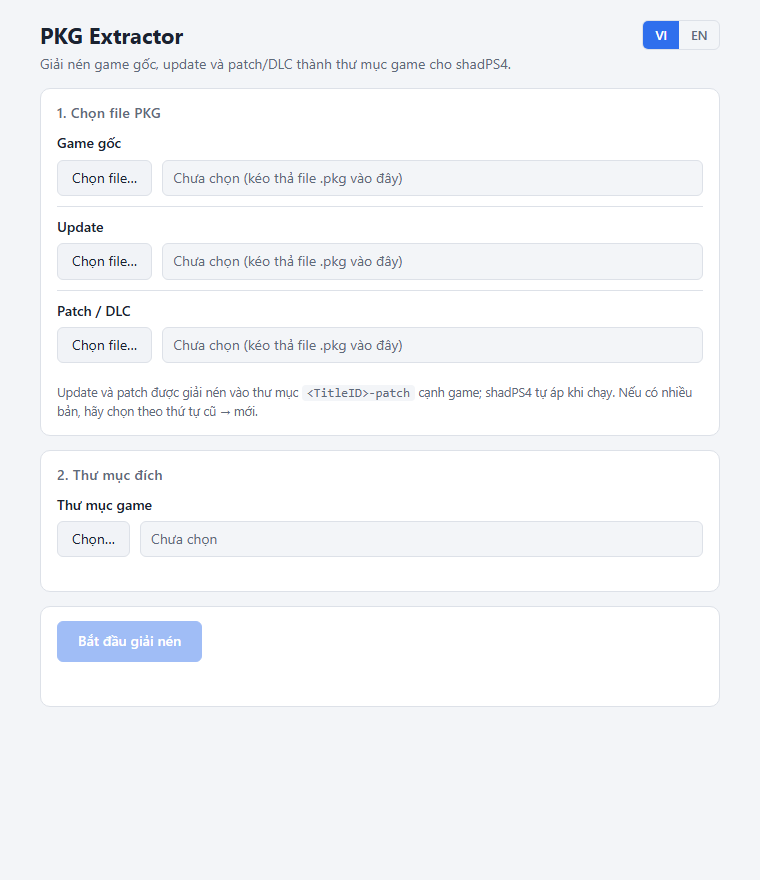
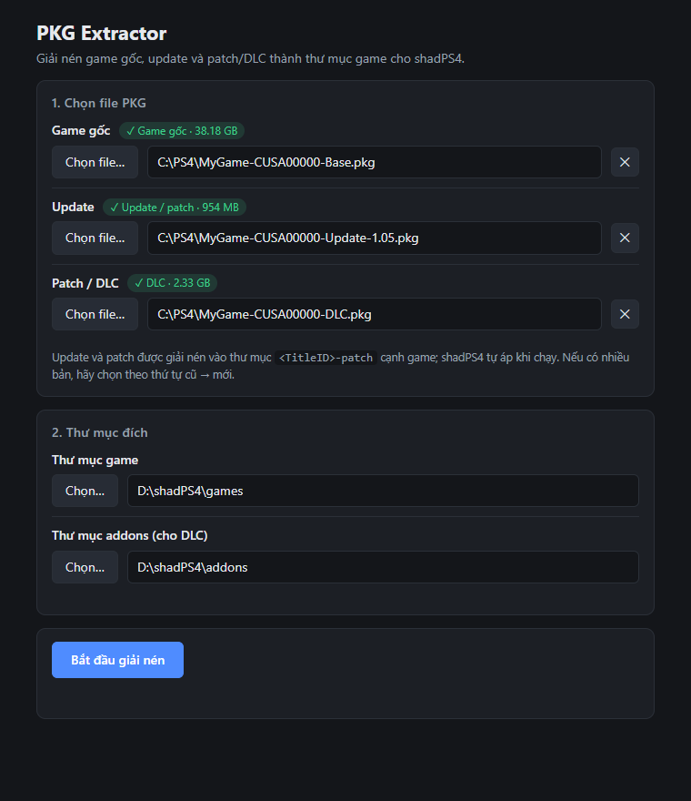
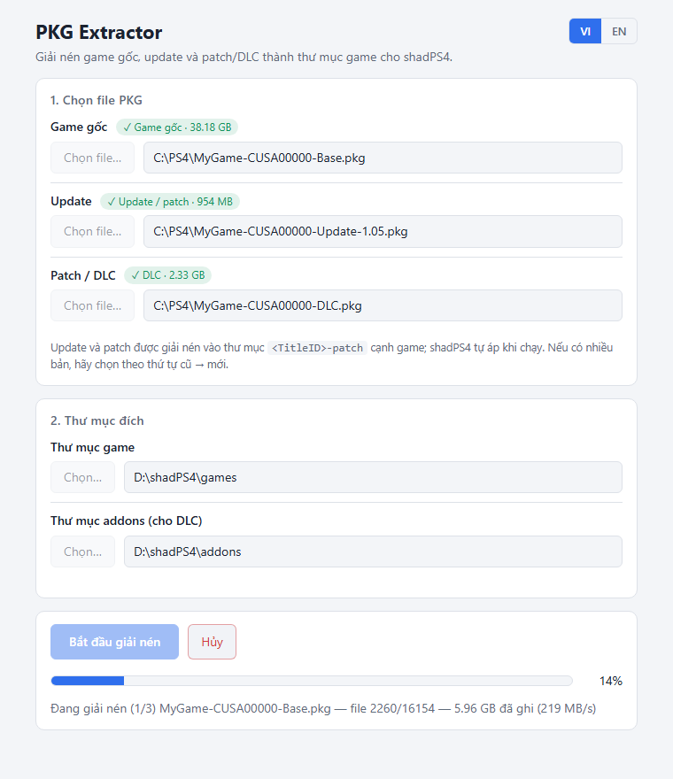
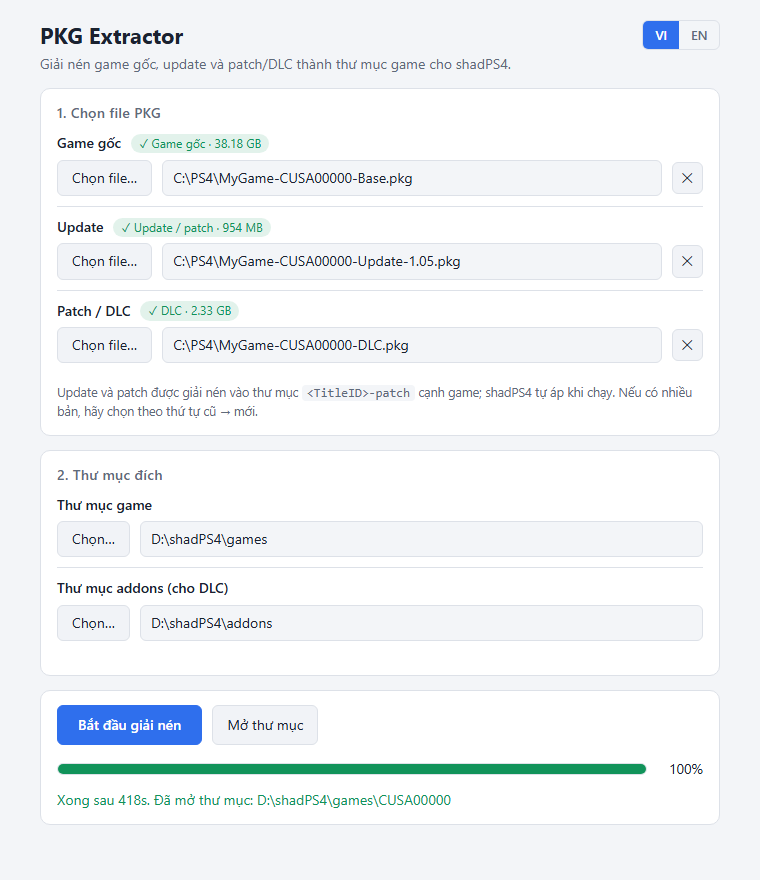

# PKG Extractor GUI

🌐 **English** · [Tiếng Việt](README.md)

Extract PS4 PKG files (base game, update, patch/DLC) into game folders for shadPS4 in a few clicks.

## Download

**[⬇ Get the latest version from the Releases page](https://github.com/ducgao/pkg-extractor-gui/releases/latest)**

Download `PKG-Extractor-GUI-x.y.z-portable.exe` and double-click it. No installation needed.

> On first launch Windows may show a SmartScreen warning because the file is not code-signed.
> Click **More info** → **Run anyway**.

## How to use

> The app interface is currently in Vietnamese. Button labels used below:
> **Chọn file…** = Choose file, **Game gốc** = Base game, **Thư mục game** = Games folder,
> **Thư mục addons** = Addons folder, **Bắt đầu giải nén** = Start extracting, **Hủy** = Cancel,
> **Mở thư mục** = Open folder.

### 1. Open the app



### 2. Pick your files and folders

- Click **Choose file…** or drag and drop a `.pkg` file onto each slot: **Base game**, **Update**, **Patch / DLC**. You don't have to fill all three.
- The app detects the type of each file. If a file is in the wrong slot it tells you immediately and disables the Start button.
- Choose the **Games folder** (and the **Addons folder** if you have a DLC). The app remembers your choice.
- If you have several updates, pick them from oldest to newest.



### 3. Click Start extracting

The progress bar shows which file is being processed, how much has been written and the speed. Click **Cancel** to stop.



### 4. Done

The games folder opens automatically. Click **Open folder** to open it again.



## Run from source

```
npm install
npm start
```

Build the portable executable with `npm run dist` (output goes to `dist/`).

## License

GPL-2.0-or-later, see [LICENSE](LICENSE).

This project bundles `pkg_extractor` (build `PKG_EXTRACTOR_1_1`) from [ShadPs4Plus](https://github.com/AzaharPlus/shadPS4Plus),
which is based on code from [shadPS4](https://github.com/shadps4-emu/shadPS4). Their source code is available in the repositories above;
the bundled build and its license are in `vendor/pkg_extractor`.
