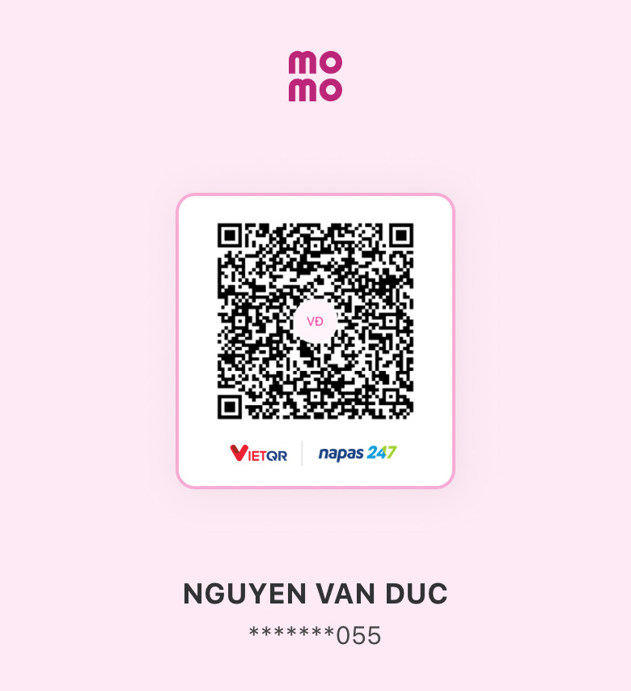

# PKG Extractor GUI

🌐 [English](README.en.md) · **Tiếng Việt**

Giải nén file PKG game PS4 (game gốc, update, patch/DLC) thành thư mục game để dùng với shadPS4, chỉ bằng vài cú bấm.

## Tải về

**[⬇ Tải bản mới nhất tại trang Releases](https://github.com/ducgao/pkg-extractor-gui/releases/latest)**

Tải file `PKG-Extractor-GUI-x.y.z-portable.exe`, bấm đúp để chạy. Không cần cài đặt.

> Lần đầu mở, Windows có thể hiện cảnh báo SmartScreen vì file chưa được ký số.
> Bấm **More info** → **Run anyway**.

## Hướng dẫn

### 1. Mở ứng dụng

Đổi ngôn ngữ bằng nút **VI / EN** ở góc trên bên phải.


### 2. Chọn file và thư mục

- Bấm **Chọn file…** hoặc kéo thả file `.pkg` vào từng ô: **Game gốc**, **Update**, **Patch / DLC**. Không cần điền đủ cả ba.
- Ứng dụng tự nhận diện loại file. Nếu chọn nhầm ô, nó báo ngay và khóa nút Bắt đầu.
- Chọn **Thư mục game** (và **Thư mục addons** nếu có DLC). Ứng dụng nhớ lựa chọn cho lần sau.
- Nếu có nhiều bản update, chọn theo thứ tự cũ → mới.


### 3. Bấm Bắt đầu giải nén

Thanh tiến độ cho biết đang xử lý file nào, đã ghi bao nhiêu và tốc độ. Bấm **Hủy** nếu muốn dừng.


### 4. Xong

Thư mục game tự mở ra. Bấm **Mở thư mục** nếu muốn mở lại.


## Chạy từ mã nguồn

```
npm install
npm start
```

Đóng gói bản portable: `npm run dist` (kết quả nằm trong `dist/`).

## License

GPL-2.0-or-later, xem [LICENSE](LICENSE).

Dự án đóng gói sẵn `pkg_extractor` (bản `PKG_EXTRACTOR_1_1`) từ [ShadPs4Plus](https://github.com/AzaharPlus/shadPS4Plus),
dựa trên mã của [shadPS4](https://github.com/shadps4-emu/shadPS4). Mã nguồn của chúng nằm ở các repo trên;
bản build và license đi kèm nằm trong `vendor/pkg_extractor`.

## Ủng hộ

Nếu ứng dụng hữu ích với bạn, bạn có thể ủng hộ tác giả qua MoMo (quét mã QR bằng ứng dụng ngân hàng hoặc MoMo):


